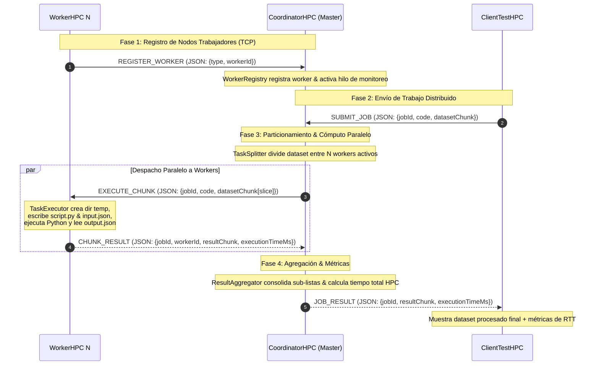

# HPC Distributed Execution Service

Sistema distribuido **HPC** desarrollado en **Java 21** para la ejecución paralela de código (**Python**) sobre grandes volúmenes de datos (*Datasets*). Comunicación mediante sockets TCP y JSON, implementando *Virtual Threads*.

---

## Arquitectura del Sistema

La arquitectura sigue el patrón **Master-Worker (Coordinador - Trabajador)**.



---

## Componentes Principales

### 1. `CoordinatorHPC` (Nodo Maestro)
- **Servidor TCP (`TCPServer`)**: Gestiona conexiones entrantes de trabajadores y clientes utilizando hilos virtuales de Java 21 (`Executors.newVirtualThreadPerTaskExecutor()`).
- **Registro de Trabajadores (`WorkerRegistry`)**: Mantiene un registro dinámico y thread-safe de los trabajadores conectados y disponibles en tiempo real. Monitorea activamente la desconexión de trabajadores.
- **Divisor de Tareas (`TaskSplitter`)**: Implementa algoritmos de particionamiento balanceado para segmentar el dataset en subconjuntos proporcionales al número de trabajadores disponibles.
- **Agregador de Resultados (`ResultAggregator`)**: Consolida las respuestas parciales devueltas por cada trabajador en el dataset final ordenado.
- **Métricas e Inspección**: Registra tiempos de particionamiento, tiempos de despacho paralelo (Round-Trip Time por worker), agregación y tiempo total de cómputo HPC.

### 2. `WorkerHPC` (Nodo Trabajador)
- **Cliente TCP (`WorkerTCPClient`)**: Se conecta al Coordinador al iniciar, envía su identificador único y se mantiene a la escucha de fragmentos de tareas (`EXECUTE_CHUNK`).
- **Motor de Ejecución (`TaskExecutor`)**:
  - Genera un **directorio temporal aislado** por cada tarea recibida.
  - Escribe el dataset en un archivo `input.json` y el código del usuario en `script.py`.
  - Invoca el proceso nativo de **Python** (`python` / `python3`) para procesar los datos.
  - Mide el tiempo de procesamiento local del trabajador y devuelve los resultados en `CHUNK_RESULT`.
  - Realiza la limpieza automática de archivos temporales al finalizar.

### 3. `ClientTestHPC` (Cliente Demo)
- Define el dataset de prueba y el bloque de código Python que debe ser ejecutado.
- Se conecta al Coordinador, transmite la solicitud mediante `SUBMIT_JOB` y espera la respuesta agregada `JOB_RESULT`.

---

## 📡 Protocolo de Comunicación (TCP + JSON)

Todos los mensajes se serializan con **Jackson** y se transmiten mediante líneas delimitadas por `\n`:

| Tipo de Mensaje (`MessageType`) | Emisor | Receptor | Descripción |
| :--- | :--- | :--- | :--- |
| `REGISTER_WORKER` | Worker | Coordinator | Registro inicial del nodo trabajador. |
| `SUBMIT_JOB` | Client | Coordinator | Envío del código Python y dataset completo. |
| `EXECUTE_CHUNK` | Coordinator | Worker | Asignación de un fragmento del dataset + código Python. |
| `CHUNK_RESULT` | Worker | Coordinator | Respuesta del trabajador con resultados parciales y tiempo de ejecución. |
| `JOB_RESULT` | Coordinator | Client | Respuesta final agregada enviada al cliente. |
| `ERROR` | Coordinator | Client/Worker | Reporte de fallos en el proceso. |

---

## Configuración (`.env`)

```
COORDINATOR_HOST=localhost
COORDINATOR_PORT=8080
```

---

### Requisitos
- **Java 21** o superior.
- **Maven**.
- **Python 3.x** accesible en el `PATH` del sistema (`python` o `python3`).

### Pasos para Ejecutar el Cluster

1. **Iniciar el Coordinador (Maestro)**:
   ```bash
   cd CoordinatorHPC
   mvn exec:java -Dexec.mainClass="upb.coordinator.CoordinatorMain"
   ```

2. **Iniciar uno o más Trabajadores (Workers)**:
   En terminales independientes:
   ```bash
   cd WorkerHPC
   mvn exec:java -Dexec.mainClass="upb.worker.WorkerMain" -Dexec.args="Worker-1"
   ```
   ```bash
   cd WorkerHPC
   mvn exec:java -Dexec.mainClass="upb.worker.WorkerMain" -Dexec.args="Worker-2"
   ```

3. **Ejecutar el Benchmark Distribuido K-Means en C (RMI)**:
   ```bash
   cd ClientTestHPC
   mvn exec:java -Dexec.mainClass="upb.client.ClientMain" -Dexec.args="localhost 1099"
   ```

---

## ⚡ Sistema HPC K-Means Distribuido en C vía Java RMI

El sistema implementa el cálculo distribuido del algoritmo **K-Means Clustering** utilizando:
1. **Coordinador RMI (Java 21)**: Publica la interfaz remota `IHpcCoordinator` en el registro RMI (`puerto 1099`). Distribuye las particiones del dataset entre los trabajadores disponibles por iteración mediante Virtual Threads, recalcula los centroides globales y evalúa la convergencia con tolerancia $\epsilon$.
2. **Nodos Trabajadores (Java 21 + C)**: Implementan `IHpcWorker` y se autorregistran en el Coordinador. Para cada iteración, el método `computeKMeansPartition` invoca el binario nativo en **C (`kmeans_worker`)** optimizado con `gcc -O3`.
3. **Motor C Nativo (`kmeans_worker.c`)**: Calcula las distancias euclidianas a los $K$ centroides en memoria de alto rendimiento y devuelve el recuento por clúster y las sumas acumuladas de coordenadas.
4. **Despliegue Multi-Contenedor**: En Docker Compose (`fylesync-hpc-master`, `fylesync-hpc-worker1`, `fylesync-hpc-worker2`, `fylesync-hpc-worker3`, `fylesync-hpc-worker4`), permitiendo benchmarks transparentes en 1, 2, 3 y 4 nodos.

### Resultados del Benchmark Multi-Nodo (Dataset 40,000 puntos, K=4, 15 iteraciones):

| Nodos | Tiempo HPC (ms) | Tiempo RTT (ms) | Iteraciones | Speedup | Eficiencia |
| :---: | :---: | :---: | :---: | :---: | :---: |
| **1** | 1063 ms | 1154 ms | 15 | **1.00x** | **100.0%** |
| **2** | 648 ms | 681 ms | 15 | **1.64x** | **82.0%** |
| **3** | 639 ms | 650 ms | 15 | **1.66x** | **55.5%** |
| **4** | 544 ms | 555 ms | 15 | **1.95x** | **48.9%** |

